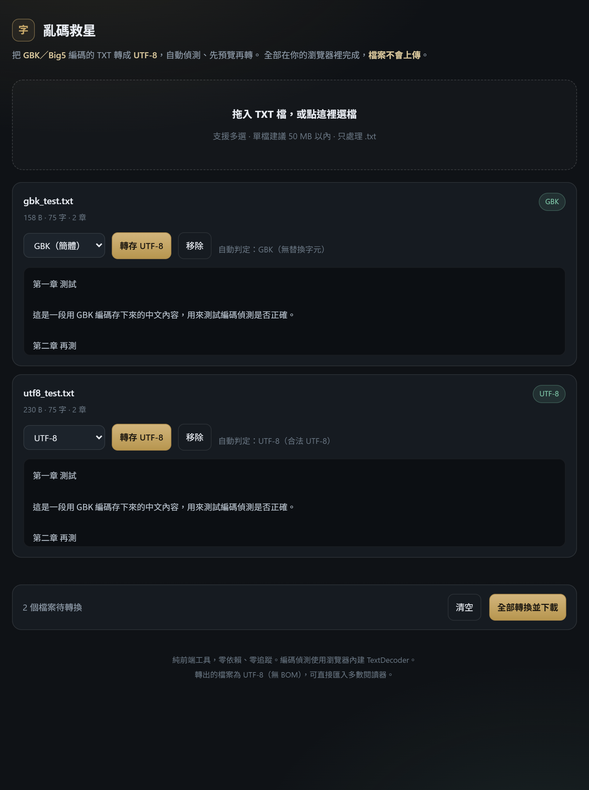

# 亂碼救星 · TXT 編碼轉換

> 把 GBK／Big5 的 TXT 轉成 UTF-8。自動偵測、先預覽再轉 —— **檔案不離開你的瀏覽器**。

<p>
  
  
  
  
</p>

<p>
  <a href="https://soul.wanderingsoul.duckdns.org/apps/txt-fix/"><b>▶ 線上直接用</b></a>
  &nbsp;·&nbsp;
  <a href="#本機執行">本機執行</a>
</p>



---

## 這是什麼

中文的 TXT 小說、字幕、歌詞、舊筆記，多半不是 UTF-8。它們可能是 **GBK（簡體）**、**Big5（繁體）** 或 **UTF-16**。丟進現代閱讀器或編輯器，就是滿頁「锟斤拷」「燙燙」和問號。

這支工具做一件事：**判斷它真正的編碼，然後轉成 UTF-8**。

- 不需要安裝，不需要上傳，不需要註冊
- 沒有伺服器 —— 所有解碼都在你的瀏覽器裡用 `TextDecoder` 完成
- 轉出來的檔案是 **UTF-8 無 BOM**，可直接匯入絕大多數閱讀器

## 功能

| 功能 | 說明 |
|---|---|
| **自動偵測** | BOM 判定 → 嚴格 UTF-8 解碼 → 不符則比對 GBK／Big5 的「亂碼率」，取最低者 |
| **手動覆寫** | 下拉可指定 GBK／Big5／UTF-8／UTF-16 LE，選了立刻重算預覽與統計 |
| **先預覽再轉** | 每張檔案卡直接顯示前幾段解碼結果，確認沒問題再下載 |
| **統計** | 檔案大小、字數、章節數（自動抓「第 X 章」「Chapter N」） |
| **多檔批次** | 一次拖入多個檔案，逐檔轉換；批次下載間隔 260 ms，避免瀏覽器攔截連續下載 |
| **可安裝** | 附 `manifest.webmanifest` 與 service worker，HTTPS 下可加到主畫面，離線也能開 |
| **零依賴** | 沒有框架、沒有 CDN、沒有追蹤腳本。單檔 HTML 12 KB（gzip 後約 5 KB） |

## 偵測邏輯

```
1. 有 BOM（EF BB BF / FF FE / FE FF）→ 直接採用
2. 用 TextDecoder('utf-8', {fatal:true}) 解碼 → 成功即 UTF-8
3. 否則分別以 GBK、Big5、UTF-16LE 解碼，計算「可疑字元比例」：
   U+FFFD（替換字元）、C0/C1 控制字元、以及 CJK 之外的零星罕用字
4. 取比例最低者；若全部偏高，仍給出最佳猜測並標註「可能有誤」
```

這不是編碼學上的完證，而是實務上夠準的啟發式：**中文檔案幾乎不會同時合法於 GBK 與 Big5**，所以亂碼率一比就能分開。

## 本機執行

純靜態檔案，雙擊就能用：

```bash
git clone https://github.com/Dahyun001/txt-fix.git
cd txt-fix
open index.html        # macOS
start index.html       # Windows
```

要測 PWA（service worker 需要 http/https，`file://` 不行）：

```bash
python -m http.server 8000
# → http://127.0.0.1:8000/
```

## 部署

任何靜態託管都能放，不需要後端：GitHub Pages、Cloudflare Pages、Netlify、Vercel、自己的 nginx。

GitHub Pages：`Settings → Pages → Deploy from a branch → main / (root)`。

## 隱私

- 檔案**從頭到尾沒有離開瀏覽器**，沒有任何 `fetch`／`XMLHttpRequest` 上傳
- 沒有 analytics、沒有 cookie、沒有外部字型
- 重新整理頁面，選過的檔案就消失（不寫入 localStorage）

## 已知限制

- 只處理 `.txt`／純文字；不支援 EPUB、DOCX、PDF
- 單檔建議 50 MB 以內（整檔讀進記憶體解碼）
- 同一檔案同時合法於多種編碼時（極少見，多為純 ASCII）會判為 UTF-8，這是安全的預設
- 簡繁轉換**不做** —— 這支工具只改編碼，不改字形。GBK 的簡體字轉成 UTF-8 之後仍然是簡體

## 授權

[MIT](LICENSE) © 2026 Dahyun001

---

同系列：[專注鐘 · 番茄計時](https://github.com/Dahyun001/pomodoro) · [Soul Reader 本地閱讀器](https://github.com/Dahyun001/soul-reader)
